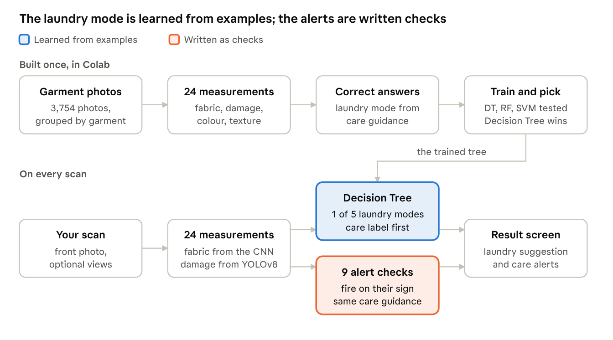

# How FabriCare Suggests Laundry Modes and Care Alerts

17 November 2026 · Copy of the Claude Doc report.

## In short

The two features were built in different ways. The laundry mode is **learned**: a model studied thousands of labelled garment photos. The care risk alerts are **written as checks**: each one waits for one sign in the scan.

- **Laundry mode suggestion.** Every training photo was given the correct laundry mode from published care guidance. Three machine-learning models then learned from those examples, and the best one, a Decision Tree, was put into the app. On each scan it looks at the fabric, any damage, the colour and the texture, and picks one of five laundry modes.
- **Care risk alerts.** Nine checks were written from the same care guidance, one for each risk worth warning about. A check fires when the scan shows its sign, such as a hole, a stain, wool, or a dark colour. It then shows a warning with one thing to do.

Both read the same scan results. The laundry suggestion also gives way to the garment's own care label when the user enters it.

## How the laundry mode suggestion was created

The laundry mode was created by teaching a model from examples. Each example is a real garment photo paired with the laundry mode that published care guidance gives for it. The work was done in the V4 Colab notebook, in six steps.

**1. Collect real garment photos.** The project's dataset gave 3,754 photos: 2,690 to learn from, 711 to tune and choose with, and 353 kept aside for the final test. All photos of the same garment stay in one group, so the test never shows the model a garment it has already seen.

**2. Describe each photo the way the app sees it.** Each photo was turned into the same 24 measurements the app takes on a scan:

- **Fabric:** cotton, denim, linen, polyester, silk or wool.
- **Damage:** holes, stains, pilling and needle marks, found by the same YOLOv8 detector the app uses. Only confident findings count.
- **Colour:** how dark and how vivid the garment is.
- **Texture:** how smooth, rough or regular the weave looks (GLCM texture).

**3. Give every photo its correct answer.** Each photo was labelled with one of five laundry modes, following published care guidance. The first rule that fits decides:

- A hole → **repair before washing**, because washing can enlarge it (ISO tear and strength standards).
- Silk → **hand wash in cold water**, or **professional cleaning** if stained, because water can mark silk (UGA Extension, Canadian Conservation Institute).
- Wool → **hand wash in cold water**, because heat and rubbing make it felt and shrink (Woolmark).
- Denim or polyester → **gentle cold machine wash**, to limit fading, dye transfer and heat damage (Levi's, UGA Extension).
- Cotton or linen that is dark, bright or pilled → **gentle cold machine wash**, to limit colour loss and friction (Cotton et al. 2020, ISO 12945-4).
- Other cotton and linen → **normal warm machine wash**.

In the test photos this gave 132 gentle cold, 117 hand wash, 94 normal warm, 8 repair first and 2 professional cleaning.

**4. Teach three models and compare them.** A Decision Tree, a Random Forest and an SVM each learned from the 2,690 training examples. They were tuned on the 711 validation photos, then tested once on the 353 test photos.

| Model | Correct on test photos (true fabric) | Correct in the full app pipeline |
| --- | --- | --- |
| Decision Tree | 99.15% | 90.65% |
| Random Forest | 99.43% | 90.93% |
| SVM | 95.75% | 87.82% |

The full-pipeline column is lower because the fabric comes from the CNN there, and a wrong fabric leads to a wrong wash.

**5. Choose the Decision Tree.** It scored best on the validation photos, the rule fixed before testing. The Random Forest's lead on test is one photo out of 353. The tree is also small (7.3 KB) and fast, and each answer follows one readable path of if-then questions.

**6. Use it on every scan.** When someone scans a garment, the app:

1. Takes the same 24 measurements from the photo. The fabric comes from the ConvNeXt-Tiny CNN.
2. Asks the Decision Tree for the laundry mode and how sure it is, shown as "model confidence".
3. Puts the garment's care label first. If the user entered it, its wash method and temperature limit replace the model's.
4. Plays it safe when the fabric is unsure (below a 60% score): it suggests a cool hand wash and asks the user to check the fibre label.
5. Adds three short steps: how to wash, what to wash with, and how to dry and iron. Gemini can reword them for the garment when its key is set.

The tree learned to apply published care guidance consistently to measured photos; it does not discover new laundry science. That is why the app names its sources and lets the care label override it.

## How the care risk alerts were created

The care risk alerts were written as nine automatic checks, not trained. Each one guards against one way a garment gets damaged in care. Each was written from the same care guidance as the laundry modes, and fires whenever its sign appears in the scan.

They were created in three steps:

1. **Pick the risks worth a warning.** The care sources name the common ways laundry harms a garment: openings that tear further, stains that set, pilling that spreads, dyes that bleed, wool that felts, silk that water-marks, polyester damaged by high heat.
2. **Tie each risk to a sign the scan can see.** Damage comes from the YOLOv8 detector, fabric from the CNN, and colour from the photo. Each alert names one clear action and a level: high (act before washing), medium (change how you wash), low (good to know).
3. **Stop false alarms.** The detector's findings count only above a set score: hole 60%, stain 70%, pilling 70%, needle mark 60%. These were set from the V4 test run. At a 40% score the detector flagged holes on 35% of mostly undamaged photos; at 90% only 3.4%. The hole threshold was later lowered from 90% to 60% after boxes lying mostly off the garment were filtered out, because at 90% real slits on phone photos never counted. Weaker findings stay on screen for the user to confirm or dismiss, and a confirmed finding always triggers its alert.

| Alert | Level | Appears when | What it tells you | Source |
| --- | --- | --- | --- | --- |
| Possible opening | High | A hole is found | Mend it before washing or wearing; pulling can enlarge it | ISO 13934-1, ISO 13937-1 |
| Possible stain | Medium | A stain is found | Identify it and test any treatment on a hidden spot; avoid hot water until then | Oregon State University Extension, GINETEX |
| Pilling | Medium | Pilling is found | Wash inside out on a gentle cycle; reduce rubbing | ISO 12945-4, Woolmark |
| Colour may bleed | Medium | The garment is dark or strongly coloured | Wash it separately in cool water | Cotton et al. 2020, GINETEX |
| Felting risk | Medium | The fabric is wool | Avoid hot water, wringing and tumble drying; dry flat | Woolmark |
| Water-mark risk | Medium | The fabric is silk | Avoid wringing and wet spot cleaning; dry out of direct sun | UGA Extension, Canadian Conservation Institute |
| Needle-like mark | Low | A needle mark is found | Check the spot for loose threads | ISO 15487, ISO 13937-1 |
| Heat-sensitive | Low | The fabric is polyester | Avoid high heat when drying or ironing | UGA Extension |
| Dye transfer | Low | The fabric is denim | Keep it away from pale items in the wash | Levi's |

One scan can raise several alerts. Dark denim with a stain, for example, shows Possible stain, Colour may bleed and Dye transfer. When the user confirms or dismisses a finding in Review findings, the alerts are worked out again from the reviewed findings.

## At a glance

The top lane ran once in Colab and produced the trained Decision Tree; the bottom lane runs on every scan, sending the same 24 measurements to the tree and to the nine alert checks.

## What they can and cannot do

Both features are reliable at applying published care guidance to what the photo shows. Neither can see what the photo hides.

**They can:**

- Give a consistent laundry mode for six fabrics and four kinds of visible damage, matching the guidance on 99% of test photos.
- Warn about the nine listed risks the moment the scan shows their sign.
- Follow the garment's care label when the user enters it, and update after the user reviews the findings.

**They cannot:**

- Know the exact fibre blend, dye or finish. A photo shows the surface, so a blend may be read as one fabric.
- Judge a fabric's strength or how bad a hole really is. The detector marks where damage appears, not how deep it goes.
- Be more right than the fabric result. When the CNN names the wrong fabric, the laundry mode and alerts follow it. This is why the full-pipeline accuracy is 90.65%, not 99%.
- Replace the care label. The app always tells the user to check it before washing.
